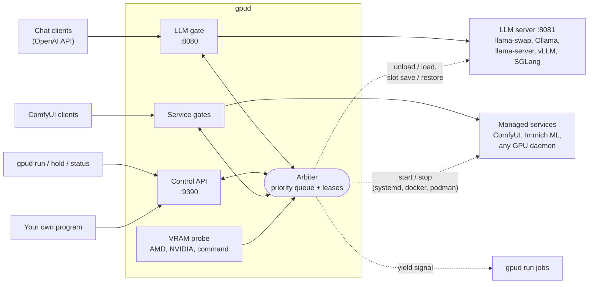
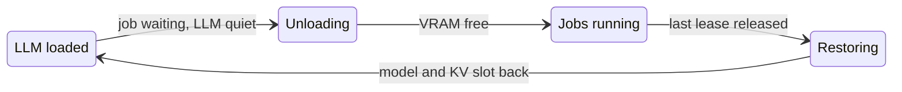

# gpud

[](https://github.com/elektricM/gpud/actions/workflows/ci.yml)
[](https://github.com/elektricM/gpud/releases/latest)
[](LICENSE)

A queue and arbiter for one GPU shared by many AI programs.

Your LLM server stays loaded so chat answers right away. When another program needs the card
(ComfyUI, a training run, whisper, vLLM, any CUDA or ROCm app), it waits in a priority queue.
gpud unloads the LLM at a quiet moment, the job runs, and the LLM comes back with its KV cache.
One static binary, no GPU libraries, no changes to your clients.

## Architecture



- **LLM gate** sits on the port your clients already use and forwards to the real server.
  Requests for GPU models are held while a job has the card. CPU-only models always pass.
- **Control API** hands out leases over HTTP. A lease is an open NDJSON stream, so it ends
  when the client exits or crashes.
- **Service gates** (optional) do the same for services like ComfyUI: a request starts the
  service and takes a lease, and the lease is released once the service is idle.
- **Arbiter** is a single task that owns all state. Everything else sends it messages.
- **VRAM probe** reads used and total memory, so jobs can share the card by declared size.

## How the queue works



Every request and job has a class. Lower number wins.

| Class | Priority | Typical use |
|---|---|---|
| `realtime` | 0 | Work that must never wait, like live transcription |
| `llm` | 1 | Requests through the LLM gate |
| `interactive` | 2 | You at the keyboard: ComfyUI, `gpud hold` |
| `background` | 3 | Services that can wait for a quiet moment, like Immich ML |
| `batch` | 4 | Training, bulk processing, long jobs |

- `background` and `batch` take the card only after the LLM has been quiet for `idle_s`.
  Other classes below the LLM wait `gap_s`.
- Jobs share the card by declared VRAM (`--vram 8G`) plus a safety margin.
- Nothing is killed. When a higher class needs the card, a yieldable job gets a signal or a
  file and exits when it is ready.
- `batch_hold_s` and `batch_hold_count` let LLM requests wait briefly behind a batch job, so
  several of them share one hand-over instead of interrupting it each time.
- When the card is free again, gpud reloads the resident model and restores its KV slot, so
  the last conversation does not have to be read again.

## Supported

**LLM servers**

| Server | How gpud frees the card | KV slot restore |
|---|---|---|
| llama-swap | unload and load at runtime | yes |
| Ollama | `keep_alive: 0`, empty generate to load | no |
| llama-server | stops and starts the service | yes |
| vLLM | stops and starts the service | no |
| SGLang | stops and starts the service | no |

**Other GPU programs**

| Kind | Examples | How |
|---|---|---|
| Managed service | ComfyUI, Immich ML, TTS or ASR servers, any CUDA/ROCm daemon | `[[service]]`, controlled by systemd, docker, podman or commands |
| Command | training, whisper, ffmpeg, scripts | `gpud run -- cmd` |
| Native client | your own program | HTTP lease API |

**GPUs**

| Vendor | VRAM reading |
|---|---|
| AMD | sysfs, tested on real hardware |
| NVIDIA | `nvidia-smi` |
| Intel or other | `command` probe: any program that prints used and total MiB |

Every integration is covered by tests against fake servers and fake service control.

## Install

| Source | How |
|---|---|
| Static binary | [latest release](https://github.com/elektricM/gpud/releases/latest), x86_64 and aarch64 |
| Debian, Ubuntu | `sudo apt install ./gpud_*_amd64.deb` from the release |
| Fedora, RHEL | `sudo dnf install ./gpud-*.x86_64.rpm` from the release |
| Arch | `packaging/aur/PKGBUILD` (AUR package coming) |
| Cargo | `cargo install --git https://github.com/elektricM/gpud` |

## Quick start

Move your LLM server from port 8080 to 8081, then write `/etc/gpud/config.toml`:

```toml
[gate]
backend = "http://127.0.0.1:8081"

[llm]
backend = "llama-swap"
resident = "chat"
```

```sh
gpud check-config
sudo systemctl enable --now gpud
```

Clients keep using port 8080. Use the user unit (`gpud.user.service`) when gpud has to
control `systemctl --user` services such as ComfyUI.

## CLI

```sh
gpud run --class batch --vram 8G --yieldable -- python train.py   # queue, run, release
gpud hold --class interactive --vram all                          # keep the card until Ctrl-C
gpud status                                                       # who has the card, who waits
gpud check-config -c examples/comfyui.toml                        # validate a config, read VRAM
```

## Documentation

- [Integrations](docs/integrations.md): plug in your LLM server, service or job
- [Configuration](docs/config.md): every key and its default
- [Lease API](docs/lease-api.md): the HTTP protocol, with a short Python client
- [Roadmap](docs/roadmap.md): desktop reclaim, multi-GPU, metrics
- [Examples](examples/): ready configs for each supported program

## License

Copyright (C) 2026 Martin Dolez

gpud is free software: you can redistribute it and/or modify it under the terms of the GNU
General Public License as published by the Free Software Foundation, either version 3 of the
License, or (at your option) any later version. See [LICENSE](LICENSE).
