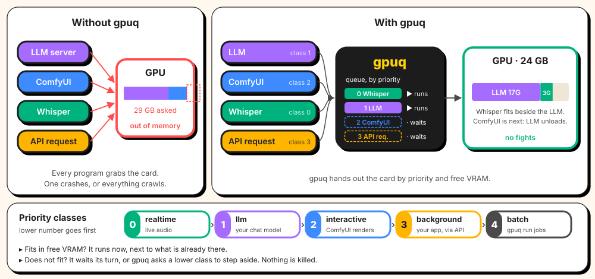

# gpuq

[](https://github.com/elektricM/gpuq/actions/workflows/ci.yml)
[](LICENSE)

gpuq is a GPU scheduler for Linux machines with one or more GPUs. Programs request the GPU
through gpuq, which grants it by priority and available VRAM. To free the card, gpuq can
signal running jobs, stop and start services, and unload models from LLM servers.

AI programs fight over the GPU: an LLM, ComfyUI, Whisper and your own tools each assume they
own the card, and whichever starts second runs out of memory. gpuq gives each one the card in
turn, by priority and free VRAM.



It works with any program that uses the GPU: renders, video encodes, simulations, games,
compute jobs, and AI tools such as LLM servers and image generators.

gpuq is in early development. The configuration format may change before 1.0.

How the scheduler works inside, with a diagram: [docs/how-it-works.md](docs/how-it-works.md).

## Features

- Priority classes, configurable
- Leases tied to a client connection, released when the client exits
- VRAM accounting, so jobs that fit can share the card
- Cooperative preemption: jobs receive a signal and exit on their own
- Service control through systemd, Docker, Podman or custom commands
- HTTP gate in front of LLM servers and services, holding requests while the GPU is busy
- Resident LLM model, reloaded with its KV cache after other jobs
- Every AMD and NVIDIA GPU detected and scheduled from one queue, with device ids worked out
  from PCI addresses; integrated GPUs can be left out
- Jobs on one card, on any card with room, or on several cards at once, granted all together
- LLM servers split over several cards, unloaded and reloaded on all of them together
- AMD and NVIDIA VRAM probes, plus a custom probe command

## Supported software

- Any command, through `gpuq run`: Blender, ffmpeg, training scripts, CUDA, ROCm or Vulkan programs
- Any service managed by systemd, Docker, Podman or custom commands
- Programs that integrate directly, through the [lease API](docs/lease-api.md)
- LLM servers, with model unloading: llama-swap, Ollama, llama.cpp `llama-server`, vLLM, SGLang
- ComfyUI, with request gating
- Immich ML, by pausing its job queues until the GPU is free, or with request gating

Example configurations are in [examples/](examples/).

## Installation

Static binaries for x86_64 and aarch64, and `.deb` and `.rpm` packages, are available on the
[releases page](https://github.com/elektricM/gpuq/releases/latest).

Building from source requires Rust 1.80 or later:

```sh
cargo install gpuq
```

Each release also has a `gpuq-<version>-vendor.tar.xz` with the dependencies, for builds
without network access. Recipes for the AUR, Fedora and openSUSE, Ubuntu and Nix are in
[packaging/](packaging/README.md). Man pages are in [man/](man) and shell completions in
[completions/](completions).

## Usage

Minimal configuration, `/etc/gpuq/config.toml`:

```toml
[llm]
backend = "none"
```

gpuq detects the GPUs itself. To leave one out, for example the CPU's integrated GPU, add
`exclude = ["0000:15:00.0"]` (its PCI address, shown by `gpuq check-config`) or
`skip_integrated = true` to a `[gpu]` table.

Start the daemon:

```sh
gpuq check-config
sudo systemctl enable --now gpuq
```

The packages ship a systemd unit; with `cargo install`, copy it from
[packaging/systemd](packaging/systemd).

Run a job:

```sh
gpuq run --class batch --vram 8G -- blender -b scene.blend -a
```

A job goes to any card with room. With several GPUs, `--card NAME` pins it to one card,
`--card gpu0,gpu1` or `--card all` gives it several cards at once, and `--cards 2` any two
cards with room. `--vram` applies to each card.

Other commands:

```
gpuq status          show the current lease holders and the queue
gpuq hold            hold the GPU until interrupted
gpuq check-config    validate the configuration and read the GPU
gpuq daemon          run the scheduler
```

To run an LLM server behind gpuq, see [docs/integrations.md](docs/integrations.md).

## Roadmap

- One LLM server per GPU
- Web UI
- Desktop and game detection
- Prometheus metrics
- Configuration reload
- Intel VRAM probe

See [docs/roadmap.md](docs/roadmap.md).

## Documentation

- [How it works](docs/how-it-works.md)
- [Integrations](docs/integrations.md)
- [Configuration reference](docs/config.md)
- [Lease API](docs/lease-api.md)
- [Roadmap](docs/roadmap.md)

## Building and testing

```sh
cargo build --release
cargo test
cargo clippy --all-targets -- -D warnings
```

The test suite does not require a GPU.

## License

Copyright (C) 2026 Martin Dolez

gpuq is licensed under the GNU General Public License v3.0 or later. See [LICENSE](LICENSE).
