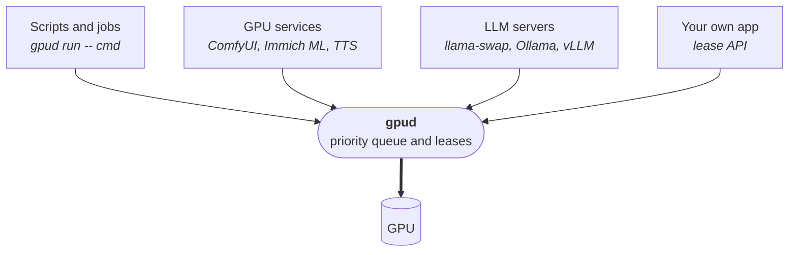

# gpud

[](https://github.com/elektricM/gpud/actions/workflows/ci.yml)
[](https://github.com/elektricM/gpud/releases/latest)
[](LICENSE)

**A scheduler for one GPU.** Every program that wants the card asks gpud first, waits its
turn by priority, and gives the card back when asked.

Running an LLM server, ComfyUI, a training script and Immich on the same card usually ends in
out-of-memory crashes or in stopping things by hand. gpud queues them instead, hands the card
over at the right moment, and starts or stops services for you.

## How it works



Every program goes through gpud before it touches the card. gpud reads the card's VRAM, grants
the card in priority order, and when someone more important arrives it asks the current holder
to yield, stops or starts its service, or unloads the LLM.

Four ideas cover everything:

- **Lease.** A program holds the card through a lease that names its class and how much VRAM it
  needs. The lease is an open connection, so it ends when the program exits or crashes.
- **Class.** Each lease has a priority class. Higher classes go first; programs that fit in the
  free VRAM can share the card.
- **Yield.** Nothing is killed. When a higher class needs the card, gpud asks a yieldable
  program to step aside (a signal, a file, or stopping its service) and waits for it.
- **Resident.** One program can be kept loaded whenever the card is idle, usually an LLM so
  chat answers right away. gpud unloads it for other work and reloads it after, KV cache
  included where the server supports it. This is optional.

## An evening with gpud

| Time | What happens | What gpud does |
|---|---|---|
| 18:00 | You chat with your local LLM | It is the resident program, already loaded |
| 18:05 | You queue a ComfyUI render | Waits for a 10 s pause in the chat, unloads the LLM, starts ComfyUI |
| 18:20 | The render is done | ComfyUI idles for 2 min, gpud stops it and reloads the LLM with its cache |
| 18:30 | `gpud run --class batch --yieldable -- train.py` | Waits until the chat has been quiet for 5 min, then runs it |
| 18:45 | A chat message arrives | Asks the training to yield; it saves and exits, the LLM reloads and answers |

All the timings are settings.

## Priorities

| Class | Default | Typical use |
|---|---|---|
| `realtime` | 0 | Must never wait, like live transcription |
| `llm` | 1 | Requests through the LLM gate |
| `interactive` | 2 | You at the keyboard: ComfyUI, `gpud hold`, a game |
| `background` | 3 | Services that can wait, like Immich ML |
| `batch` | 4 | Training, bulk processing |

Lower number wins. The order is yours to change, for example to put your own work above the LLM:

```toml
[classes]
interactive = 1
llm = 2
```

## What you can plug in

| Type | Programs | gpud controls it by |
|---|---|---|
| Command | training, whisper, ffmpeg, any CUDA or ROCm script | `gpud run`, yield by signal or file |
| GPU service | ComfyUI, Immich ML, TTS or ASR servers, any GPU daemon | systemd, docker, podman or commands, with an optional request gate |
| LLM server | llama-swap, Ollama, llama-server, vLLM, SGLang | unload and reload at runtime, or stop and start the service |
| Your own app | anything that can open an HTTP connection | the [lease API](docs/lease-api.md) |

GPUs: AMD (sysfs) and NVIDIA (`nvidia-smi`). Anything else works through a `command` probe
that prints used and total MiB.

The [integrations guide](docs/integrations.md) has a ready config for each program in
[examples/](examples/).

## Getting started

**Install**

| System | How |
|---|---|
| Any Linux | static binary from the [latest release](https://github.com/elektricM/gpud/releases/latest) (x86_64, aarch64) |
| Debian, Ubuntu | `sudo apt install ./gpud_*_amd64.deb` from the release |
| Fedora, RHEL | `sudo dnf install ./gpud-*.x86_64.rpm` from the release |
| Arch | `packaging/aur/PKGBUILD` (AUR package coming) |
| From source | `cargo install --git https://github.com/elektricM/gpud` |

**Configure** `/etc/gpud/config.toml`. The smallest setup, jobs only, no LLM:

```toml
[llm]
backend = "none"
```

With an LLM server: move it from port 8080 to 8081, and gpud takes 8080 so your clients do
not change.

```toml
[gate]
backend = "http://127.0.0.1:8081"

[llm]
backend = "llama-swap"     # or ollama, llama-server, vllm, sglang
resident = "chat"
```

**Run**

```sh
gpud check-config                 # validates the file and reads your GPU
sudo systemctl enable --now gpud
```

Use the user unit (`gpud.user.service`) instead when gpud has to control `systemctl --user`
services.

## Commands

```sh
gpud run --class batch --vram 8G --yieldable -- python train.py   # wait, run, release
gpud hold --class interactive --vram all                          # take the whole card until Ctrl-C
gpud status                                                       # who has the card, who waits
gpud check-config -c examples/comfyui.toml                        # check a config before using it
```

## Roadmap

| Planned | Until then |
|---|---|
| Automatic desktop and game detection, card handed back afterwards | `gpud run --class interactive --vram all -- game` |
| Multi-GPU support: one queue for several cards, leases that name a card or take any free one | one card per gpud for now |
| Web UI: live view of the card, the queue and the leases, with buttons to hold, release or ask a job to yield | `gpud status` |
| Prometheus metrics | `gpud status` and `GET /status` |
| Config reload without restart | restart the service; live leases are re-adopted |
| Intel VRAM probe | the `command` probe |
| Immich adapter that pauses its job queues | Immich ML as a gated service |

Details in [docs/roadmap.md](docs/roadmap.md).

## Documentation

- [Integrations](docs/integrations.md): how to plug in each kind of program
- [Configuration](docs/config.md): every key and its default
- [Lease API](docs/lease-api.md): the HTTP protocol, with a short Python client
- [Examples](examples/): ready configs

## License

Copyright (C) 2026 Martin Dolez

gpud is free software: you can redistribute it and/or modify it under the terms of the GNU
General Public License as published by the Free Software Foundation, either version 3 of the
License, or (at your option) any later version. See [LICENSE](LICENSE).
