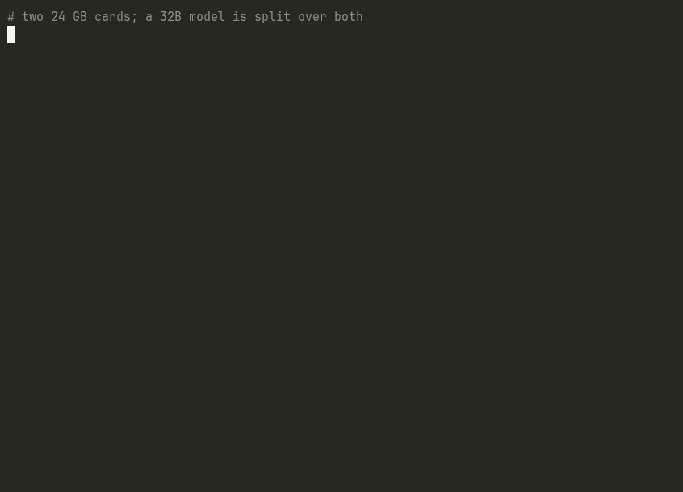
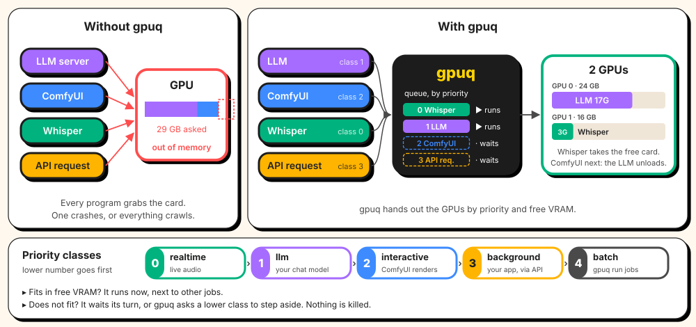

# gpuq

[](https://github.com/elektricM/gpuq/actions/workflows/ci.yml)
[](LICENSE)

```
torch.OutOfMemoryError: CUDA out of memory. Tried to allocate 2.00 GiB. GPU 0 has a total
capacity of 23.57 GiB of which 1.06 GiB is free.
```

```
ggml_backend_cuda_buffer_type_alloc_buffer: allocating 9216.00 MiB on device 0: cudaMalloc
failed: out of memory
```

This is what you get when several programs share a GPU. Ollama keeps a model loaded, ComfyUI
starts a workflow, a training script starts, and whichever asks for VRAM last fails. Each one
assumes it has the card to itself.

gpuq is a scheduler for Linux machines with one or more GPUs that hands the cards out in turn,
by priority and free VRAM. Programs that fit run side by side. When one does not fit, it
waits, or gpuq makes room: it unloads the model from the LLM server, stops a service, or
signals a lower-priority job so it can exit cleanly. HTTP requests to Ollama, ComfyUI and
similar servers are held until the card is free, so their clients do not need to know about
gpuq.

It is for a home server where Ollama, ComfyUI, Whisper and Immich share one card, a gaming PC
whose card also runs local AI, or a lab machine where several people run jobs on the same
GPUs.



*Two 24 GB cards. A model split over both is unloaded for three jobs, a fourth job waits for
room, and the model comes back on both cards when the jobs are done. Recorded with pretend
cards and stand-in programs ([docs/demo](docs/demo/)); the scheduling is gpuq's own.*

## Quick start

```sh
curl -fsSL https://raw.githubusercontent.com/elektricM/gpuq/main/install.sh | sh
mkdir -p ~/.config/gpuq
printf '[llm]\nbackend = "none"\n' > ~/.config/gpuq/config.toml
gpuq check-config        # lists the GPUs gpuq found
gpuq daemon
```

In another terminal:

```sh
gpuq run --class batch --vram 8G -- blender -b scene.blend -a
gpuq status              # the lease, the queue and each card's VRAM
```

A second `gpuq run` that does not fit next to the first waits in the queue until the card has
room. To put Ollama, ComfyUI or another server behind gpuq, see
[docs/integrations.md](docs/integrations.md) and the configs in [examples/](examples/).

gpuq works with any program that uses the GPU, not only AI tools: renders, video encodes,
simulations and compute jobs go through `gpuq run`. It is in early development; the
configuration format may change before 1.0.



How the scheduler works inside: [docs/how-it-works.md](docs/how-it-works.md).

## Features

- Priority classes, configurable
- Leases tied to a client connection, released when the client exits
- VRAM accounting, so jobs that fit can share the card
- Cooperative preemption: jobs receive a signal and exit on their own
- Service control through systemd, Docker, Podman or custom commands
- HTTP gate in front of LLM servers and services, holding requests while the GPU is busy
- Resident LLM model, reloaded with its KV cache after other jobs
- Every AMD and NVIDIA GPU detected and scheduled from one queue, with device ids worked out
  from PCI addresses; integrated GPUs can be left out
- Jobs on one card, on any card with room, or on several cards at once, granted all together
- LLM servers split over several cards, unloaded and reloaded on all of them together
- Optional per-class model hold: while an important client uses the LLM server, requests for
  other models from less important clients wait, so a server with one model at a time does
  not swap back and forth
- AMD and NVIDIA VRAM probes, plus a custom probe command
- Optional: the graphical desktop is stopped or moved to another GPU while its VRAM is needed,
  and given back afterwards

## Supported software

- Any command, through `gpuq run`: Blender, ffmpeg, training scripts, CUDA, ROCm or Vulkan programs
- Any service managed by systemd, Docker, Podman or custom commands
- Programs that integrate directly, through the [lease API](docs/lease-api.md)
- LLM servers, with model unloading: llama-swap, Ollama, llama.cpp `llama-server`, vLLM, SGLang
- ComfyUI, with request gating
- Immich ML, by pausing its job queues until the GPU is free, or with request gating

Example configurations are in [examples/](examples/).

## Installation

Static binaries for x86_64 and aarch64, and `.deb` and `.rpm` packages, are available on the
[releases page](https://github.com/elektricM/gpuq/releases/latest). `install.sh` downloads the
binary for your machine, checks it against the release's `SHA256SUMS` and installs it to
`~/.local/bin`, or to `/usr/local/bin` with `--system`:

```sh
curl -fsSL https://raw.githubusercontent.com/elektricM/gpuq/main/install.sh | sh
```

Building from source requires Rust 1.80 or later:

```sh
cargo install gpuq
```

Each release also has a `gpuq-<version>-vendor.tar.xz` with the dependencies, for builds
without network access. Recipes for the AUR, Fedora and openSUSE, Ubuntu and Nix are in
[packaging/](packaging/README.md). Man pages are in [man/](man) and shell completions in
[completions/](completions).

## Usage

Minimal system configuration, `/etc/gpuq/config.toml`:

```toml
[llm]
backend = "none"
```

gpuq detects the GPUs itself. To leave one out, for example the CPU's integrated GPU, add
`exclude = ["0000:15:00.0"]` (its PCI address, shown by `gpuq check-config`) or
`skip_integrated = true` to a `[gpu]` table.

Start the daemon as a service:

```sh
gpuq check-config
sudo systemctl enable --now gpuq
```

The packages ship a systemd unit; with `cargo install`, copy it from
[packaging/systemd](packaging/systemd).

Run a job:

```sh
gpuq run --class batch --vram 8G -- blender -b scene.blend -a
```

A job goes to any card with room. With several GPUs, `--card NAME` pins it to one card,
`--card gpu0,gpu1` or `--card all` gives it several cards at once, and `--cards 2` any two
cards with room. `--vram` applies to each card.

Other commands:

```
gpuq status          show the current lease holders and the queue
gpuq hold            hold the GPU until interrupted
gpuq check-config    validate the configuration and read the GPUs
gpuq daemon          run the scheduler
gpuq desktop         see "The desktop" below
```

To run an LLM server behind gpuq, see [docs/integrations.md](docs/integrations.md).

### The desktop

On a machine used mostly remotely, the display manager and the session hold VRAM on the card.
With `[desktop] policy = "stop"`, gpuq stops them while a large model is loaded or a job does
not fit, and starts the display manager again later. `policy = "offload"` restarts the desktop
on another GPU instead, when the monitors are connected there. Nothing happens while someone is
logged in at the seat. See [docs/desktop.md](docs/desktop.md).

```
gpuq desktop                 state and the processes on the card
gpuq desktop restore         give the desktop back now
```

## Roadmap

- One LLM server per GPU
- Web UI
- Foreground and game detection
- Prometheus metrics
- Configuration reload
- Intel VRAM probe

See [docs/roadmap.md](docs/roadmap.md).

## Documentation

- [How it works](docs/how-it-works.md)
- [Integrations](docs/integrations.md)
- [Configuration reference](docs/config.md)
- [The desktop](docs/desktop.md)
- [Lease API](docs/lease-api.md)
- [Roadmap](docs/roadmap.md)

## Building and testing

```sh
cargo build --release
cargo test
cargo clippy --all-targets -- -D warnings
```

The test suite does not require a GPU.

## License

Copyright (C) 2026 Martin Dolez

gpuq is licensed under the GNU General Public License v3.0 or later. See [LICENSE](LICENSE).
