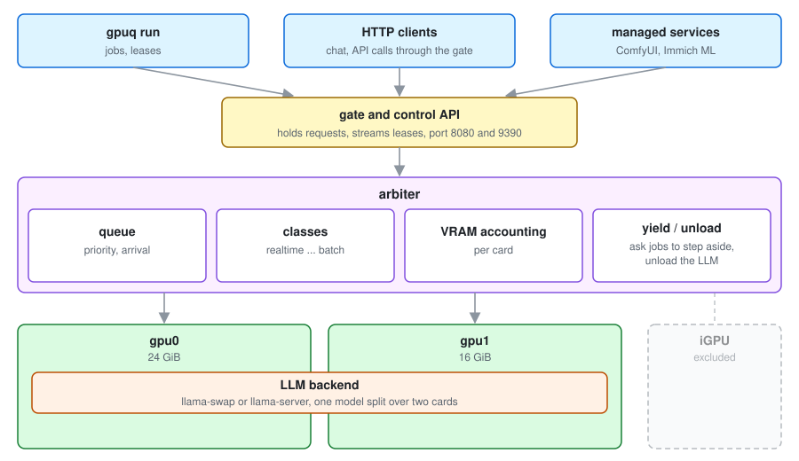

# How gpuq works



gpuq rests on four ideas.

- **Lease.** A program holds the card through a lease that names its class and how much VRAM it
  needs. The lease is an open connection, so it ends when the program exits or crashes.
- **Class.** Each lease has a priority class. Higher classes go first; programs that fit in the
  free VRAM can share the card.
- **Yield.** Nothing is killed. When a higher class needs the card, gpuq asks a yieldable
  program to step aside (a signal, a file, or stopping its service) and waits for it.
- **Resident.** One program can be kept loaded whenever the card is idle, usually an LLM so
  chat answers right away. gpuq unloads it for other work and reloads it after, KV cache
  included where the server supports it. This is optional.

## An evening with gpuq

| Time | What happens | What gpuq does |
|---|---|---|
| 18:00 | You chat with your local LLM | It is the resident program, already loaded |
| 18:05 | You queue a ComfyUI render | Waits for a 10 s pause in the chat, unloads the LLM, starts ComfyUI |
| 18:20 | The render is done | ComfyUI idles for 2 min, gpuq stops it and reloads the LLM with its cache |
| 18:30 | `gpuq run --class batch --yieldable -- train.py` | Waits until the chat has been quiet for 5 min, then runs it |
| 18:45 | A chat message arrives | Asks the training to yield; it saves and exits, the LLM reloads and answers |

All the timings are settings.

## Several cards

gpuq finds every GPU on the machine and manages all of them from one queue, unless you leave
some out (`gpu.exclude`, `gpu.skip_integrated`) or list the cards yourself. Every card has its
own state, its own VRAM accounting and its own yields.

- A job that names no card goes to any card with room. `--card NAME` pins it to one card.
- A waiter only blocks on the cards it can use. A job pinned to one card never holds up a
  job for another.
- Yields are per card: when the LLM needs a card back, only the yieldable jobs on that card
  are asked to step aside.
- If no card has room, a job waits under the rules of the cards it can use, including the
  LLM's idle timers on the LLM's cards.

### One job on several cards

`gpuq run --card gpu0,gpu1`, `--card all` or `--cards 2` holds several cards at once, the way
llama.cpp or PyTorch split one model over GPUs. The job gets the env of all its cards in one
list, for example `CUDA_VISIBLE_DEVICES=GPU-a,GPU-b`, and `GPUQ_CARD=gpu0,gpu1`.

- **All or nothing.** The lease is granted once every card it needs fits, in one step. It never
  holds one card while it waits for another, so two such leases cannot block each other.
- **No starvation.** A waiting multi-card lease is first in line on each of its cards for
  everything of its class or below that came later. A stream of single-card jobs cannot keep
  it waiting forever: each card it needs is kept for it as soon as its holders leave. More
  important classes still go first, as everywhere.
- **No pointless yields.** Yieldable jobs on its cards are only asked to step aside once all
  of its cards could be had. While one card stays blocked by a job that cannot yield, the
  others keep running, and the LLM is not unloaded for it.
- **Yield.** A yieldable multi-card lease is asked to yield when something more important
  needs any one of its cards.

### The LLM on several cards

`llm.card = ["gpu0", "gpu1"]` puts the LLM server on two cards, and `[llm.models]` can give one
model its own cards. A model whose VRAM need is known (from `[llm.models]`, or estimated from
its GGUF files with llama-swap) and does not fit on the LLM's card gets the fewest extra cards
that fit it, like llama.cpp spreading layers over every visible GPU. A model that fits on one
card stays on one card.

The LLM takes its cards together and gives them back together: their VRAM is counted as the
LLM's, a job that needs any one of them unloads the server from all of them, and the reload
waits until all of them are free again.

Details are in [integrations.md](integrations.md#several-gpus) and
[config.md](config.md#detected-cards).

## Priorities

| Class | Default | Typical use |
|---|---|---|
| `realtime` | 0 | Must never wait, like live transcription |
| `llm` | 1 | Requests through the LLM gate |
| `interactive` | 2 | You at the keyboard: ComfyUI, `gpuq hold`, a game |
| `background` | 3 | Services that can wait, like Immich ML |
| `batch` | 4 | Training, bulk processing |

Lower number wins. The order is yours to change, for example to put your own work above the LLM:

```toml
[classes]
interactive = 1
llm = 2
```

Details of every timing and class setting are in [config.md](config.md).

## One model at a time

An LLM server that holds one model at a time swaps whenever the next request asks for
another model. With two clients on two models, that is a cold load at every turn. A class
with `hold_other_models_s` (see `[llm.class_tuning]` in config.md) keeps the server on its
model: while it has requests in flight, and for that long after the last one, requests of
less important classes for another model wait in the queue. They go through together once the
class has been quiet, so the server swaps once each way.

